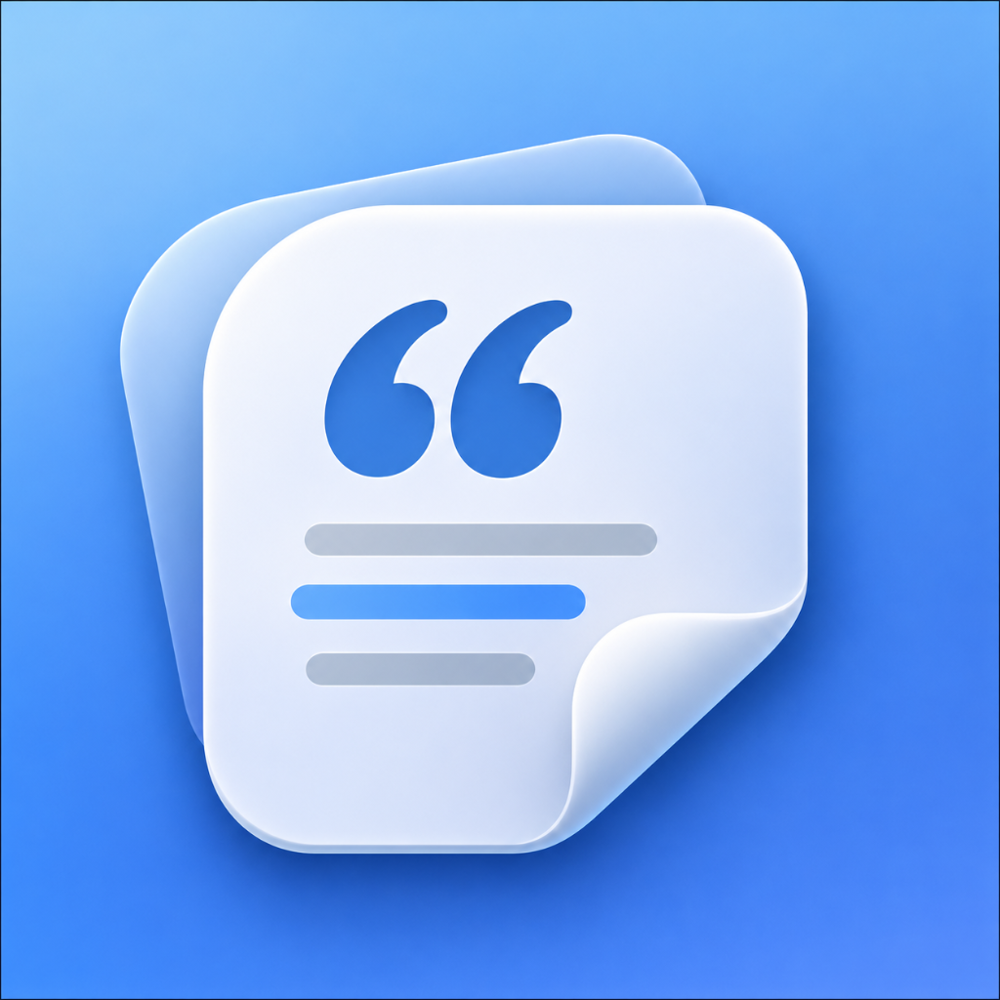

<div align="center">



# Glossa

**Read PDFs and books. Annotate. Write Markdown. One quiet, native Mac app.**

[](https://github.com/effe1209/Glossa)
[](https://github.com/effe1209/Glossa/releases)
[](LICENSE)
[](https://www.apple.com/macos/)

</div>

---

Glossa is a native macOS app for reading and annotating PDFs and EPUB books and for writing Markdown notes, all in the same tabs and windows. It is built with SwiftUI and AppKit, using PDFKit for PDFs, TextKit 2 for Markdown and TextKit 1 for EPUB. Every tool stays out of sight until you reach for it.

It is meant for people who work from documents: you read a paper, mark the passages that matter, and write your notes next to it without switching apps.

> **Glossa is derived from [PageFlow](https://github.com/pinchen147/PageFlow)**, created by Pin Chen and released under the Apache License 2.0. Glossa keeps PageFlow's history and continues it as an independent project. See [Origin and attribution](#origin-and-attribution).

## Features

### PDF reader

- **Layouts**: single page, continuous and two-page layouts, plus password-protected PDFs. A PDF's own copy, print and edit restrictions are respected.
- **Annotations**: highlight (⇧⌘H), underline (⌘U) and comment (⇧⌘K). Annotations are written into the PDF; comments render LaTeX.
- **Bookmarks**: toggle with ⌘D. Bookmarks are stored in the PDF's outline, under a "Glossa Bookmarks" entry, as well as on your Mac. Bookmarks from earlier versions are still read.
- **Pages**: rotate, copy, cut, paste, delete, duplicate, reorder and insert pages from the thumbnail sidebar or the Edit menu, all undoable. Insert a blank page (⌥⌘N) or every page of another PDF (⇧⌥⌘N).
- **PDF to Markdown**: copy a page (⇧⌘M), an outline section or the whole document (⌥⇧⌘M) as Markdown.

### EPUB reader

- Pages use the same layouts as PDF, with Reflow to Fit, System, Light, Sepia and Dark pages, and settings for font, size, line height, margins, justification, hyphenation and paragraph spacing.
- Contents, bookmarks, whole-book Find, a page rail, and Go to Page that accepts a book's print page numbers.
- Highlights, underlines and notes, listed in the sidebar and exportable as Markdown.
- Read aloud with the Mac's voices, offline.
- Footnote pop-ups, MathML formulas, right-to-left text, ruby and vertical Chinese and Japanese text. DRM-protected books are reported as unopenable.

### Markdown editor

- **Live preview**: notes render as you type; the markup shows only where you are editing.
- **Split view**: source on one side, an uneditable preview on the other.
- **Tables, math, diagrams, code**: editable tables, `$…$` and `$$…$$` LaTeX, Mermaid diagrams and syntax colouring.
- **Comments in the file**: threads in the margin, saved in a hidden block at the end of the `.md`.
- **Wiki-links**: `[[Note]]`, `[[Note|Alias]]` and `[[Note#Heading]]` open the note, PDF or book they name.
- **Plain files**: `.md` and `.markdown` anywhere on your Mac; pasted images go to an `attachments` folder beside the note.
- **Outline, Find and Replace, zoom, print, page width**: a heading outline, Find and Replace (⌥⌘F), and an adjustable page width in Settings → Notes.

### Markup tools and palettes

- Highlight, underline and comment colours are presets you edit in Settings → Annotations: add, rename, recolour and remove them, or reset to the Glossa defaults (yellow, green, blue and pink for highlights and underlines).
- Your changes are kept in a versioned layer on top of the built-in defaults, so a future update to the defaults does not overwrite your choices. Resetting keeps a backup that can be restored.
- Changing a palette never recolours annotations you have already made.
- Colour presets saved by earlier versions are migrated without being deleted.
- Underline colours that would be hard to read on the page are adjusted for contrast.

### Tabs, navigation and windows

- **Tabs**: an adaptive tab strip that uses the width available, a tab size you set in Settings → General, and a Deck layout where the current tab stays full width and the rest tuck beside it.
- **Windows**: tear tabs off into windows and merge them back, Search Tabs across every window (⇧⌘A), undo kept per tab, and your documents reopened on relaunch, each where you left off.
- **Navigation rails**: PDF pages, Markdown headings and EPUB pages have rails along the edge: hover to preview, click to jump. They can be turned off or shown only at the edge in Settings → General → Navigation.
- **Toolbar**: a folding glass toolbar with an adjustable size.
- **Rebindable shortcuts**: Settings → Shortcuts, searchable by name or by keys.

### Export

- **Markdown notes and PDFs**: File → Export As, to PDF, HTML or a Word document (.docx). A PDF is exported from its extracted text, and only when the PDF allows copying.
- **EPUB highlights**: Export Highlights as Markdown, to a file or a new tab.

## Workflow: PDF and Markdown together

1. Open a paper as a PDF and a note as Markdown in two tabs, or tear one off into its own window.
2. Highlight and underline in the PDF using your palette, add comments, and bookmark pages with ⌘D.
3. Copy a page or the whole document as Markdown (⇧⌘M, ⌥⇧⌘M) into your note, or link to the PDF with a wiki-link.
4. Write with live preview or in split view, then export the note as PDF, HTML or Word when it is ready to share.

## Screenshots

There are no screenshots of Glossa in the repository yet. The image that came with the original project showed PageFlow 2.0, so it is no longer used here. Screenshots will be added once they are taken from Glossa itself.

## Install

Glossa is not distributed as a prebuilt download yet. The [releases page](https://github.com/effe1209/Glossa/releases) is where installers will be published; until a release appears there, build it from source (below).

**Requirements:** macOS 15 (Sequoia) or later, and Xcode to build it. Glossa has a Liquid Glass look on macOS 26 and a frosted look on macOS 15.

## Build from source

```bash
git clone https://github.com/effe1209/Glossa.git
cd Glossa
xcodebuild -project PageFlow.xcodeproj -scheme "PageFlow Direct" -configuration Release-Direct CODE_SIGNING_ALLOWED=NO build
```

The Xcode project and its schemes keep their original `PageFlow` names; the app they build is **Glossa.app**. The `PageFlow` scheme builds the sandboxed configuration and `PageFlow Direct` the non-sandboxed one. Xcode resolves the Swift Package Manager dependencies on the first build.

The `Tests` folder holds two Swift packages. Run each with `swift test`:

```bash
cd Tests/TabWidthLayoutTests && swift test
cd Tests/MarkupPaletteTests && swift test
```

## Privacy

Glossa has no analytics, no telemetry, no account and no updater, so new versions come from the releases page. Your documents stay where you saved them: annotations are written into the PDF, comments into the Markdown file, and settings are kept on your Mac.

Glossa does not have a networking layer of its own: a review of the app's source and its bundled and third-party dependencies found no `URLSession`, `Network.framework` or socket code. That is a source review, not a network capture, and a few things can still reach the network:

- **Remote images in the Markdown split view.** The preview is rendered with WebKit, so an image that a note references by `http(s)` URL is loaded from that address when the preview is open.
- **Links and Help.** Links you open, and the Help menu item (which opens a website), are handed to your default browser.
- **macOS services.** Anything macOS itself does on an app's behalf is outside Glossa's control.

The sandboxed build also carries the `com.apple.security.network.client` entitlement.

## Keyboard shortcuts

| Action | Shortcut |
|--------|----------|
| New Markdown note / New tab / New window | `⌘N` / `⌘T` / `⇧⌘N` |
| Open / Save / Save As | `⌘O` / `⌘S` / `⇧⌘S` |
| Find / Find and Replace / Next / Previous | `⌘F` / `⌥⌘F` / `⌘G` / `⇧⌘G` |
| Go to Page or Line / Back / Forward | `⌥⌘G` / `⌘[` / `⌘]` |
| Bold / Italic / Underline / Strikethrough | `⌘B` / `⌘I` / `⌘U` / `⇧⌘X` |
| Code / Highlight (Markdown) / Clear formatting | `⇧⌘C` / `⇧⌘H` / `⌘\` |
| Link / Heading 1–6 / Normal text | `⌘K` / `⌥⌘1`–`⌥⌘6` / `⌥⌘7` |
| Bulleted / Numbered list / Checklist | `⇧⌘8` / `⇧⌘7` / `⇧⌘L` |
| Quote / Code block / Table | `⇧⌘9` / `⌥⌘C` / `⌥⌘T` |
| Align left / Center / Align right / Justify (Markdown) | `⌘L` / `⌘E` / `⌘R` / `⌘J` |
| Move line up / down | `⌃⌘↑` / `⌃⌘↓` |
| Check or uncheck item (Markdown) | `⌘↩` |
| Highlight / Add comment or note (PDF, EPUB, Markdown) | `⇧⌘H` / `⇧⌘K` |
| Underline (PDF, EPUB) | `⌘U` |
| Read aloud / Pause (EPUB) | `⌥R` / `⌥P` |
| Insert blank page / Insert pages from file (PDF) | `⌥⌘N` / `⇧⌥⌘N` |
| Rotate page clockwise / counter-clockwise (PDF) | `⌘R` / `⇧⌘R` |
| Bookmark (PDF, EPUB) | `⌘D` |
| Copy page / document as Markdown (PDF) | `⇧⌘M` / `⌥⇧⌘M` |
| Zoom in / out / Actual Size / Zoom to Fit | `⌘+` / `⌘-` / `⌘0` / `⌥⌘0` |
| Show sidebar / Show comments or notes | `⌥⌘S` / `⌥⌘E` |
| Fold or expand current section | `⌥⌘↩` |
| Search Tabs / Next tab / Previous tab / Tab 1–9 | `⇧⌘A` / `⇧⌘]` / `⇧⌘[` / `⌘1`–`⌘9` |
| Reopen closed tab / Previously used tab, forward and back (hold ⌃ to go further) | `⇧⌘T` / `⌃⇥` / `⌃⇧⇥` |

These are the defaults. You can change any binding in Settings → Shortcuts.

## Changelog

Glossa's release notes will be published on the [releases page](https://github.com/effe1209/Glossa/releases). Changes merged so far, in [pull request #1](https://github.com/effe1209/Glossa/pull/1):

- Product renamed to Glossa, with a new app icon and new PDF and Markdown document icons.
- Versioned markup palettes with customisable highlight and underline colours.
- Adaptive tab widths and a tab size setting, sticky markup tools, undo and redo in the toolbar.
- Markdown split view, an adjustable page width, and Export As PDF, HTML or Word.
- Bookmarks stored in the PDF's outline.

For the history before Glossa, see the [PageFlow repository](https://github.com/pinchen147/PageFlow) and its [release notes](https://pageflow.pinchen.me/changelog).

## Origin and attribution

Glossa is derived from [PageFlow](https://github.com/pinchen147/PageFlow) by Pin Chen, which is licensed under the Apache License 2.0, and it keeps the original project's Git history. The bundle identifier (`com.raccoontechnologies.PageFlow`) and the Xcode project and scheme names are unchanged from PageFlow. The plan for separating them is in [`docs/GLOSSA-IDENTITY-SEPARATION.md`](docs/GLOSSA-IDENTITY-SEPARATION.md).

Glossa also builds on open-source components, listed with their licenses in [THIRD-PARTY-LICENSES.md](THIRD-PARTY-LICENSES.md).

## License

Glossa is released under the [Apache License 2.0](LICENSE), Copyright 2025 Pin Chen for the original PageFlow. The original copyright and license notices are kept as they are.
