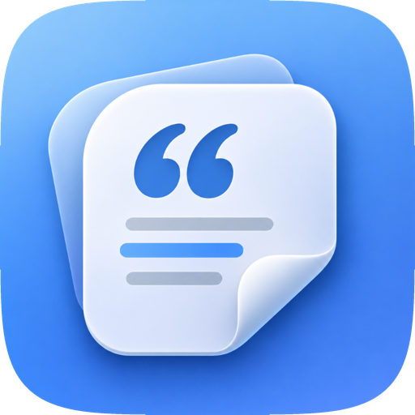

<div align="center">



# Glossa

**Read PDFs and books. Annotate. Write Markdown. One quiet, native Mac app.**

[](https://github.com/effe1209/Glossa)
[](https://github.com/effe1209/Glossa/releases)
[](LICENSE)
[](https://www.apple.com/macos/)

</div>

---

Glossa is a native macOS app for reading and annotating PDFs and EPUB books and for writing Markdown notes, all in the same tabs and windows. It is built with SwiftUI and AppKit, using PDFKit for PDFs, TextKit 2 for Markdown and TextKit 1 for EPUB. Every tool stays out of sight until you reach for it.

It is meant for people who work from documents: you read a paper, mark the passages that matter, and write your notes next to it without switching apps.

> **Glossa is derived from [PageFlow](https://github.com/pinchen147/PageFlow)**, created by Pin Chen and released under the Apache License 2.0. Glossa keeps PageFlow's history and continues it as an independent project. See [Origin and attribution](#origin-and-attribution).

## Features

### PDF reader

- **Layouts**: single page, continuous and two-page layouts, plus password-protected PDFs. A PDF's own copy, print and edit restrictions are respected.
- **Annotations**: highlight (⇧⌘H), underline (⌘U) and comment (⇧⌘K). Annotations are written into the PDF; comments render LaTeX.
- **Bookmarks**: toggle with ⌘D. Bookmarks are stored in the PDF's outline, under a "Glossa Bookmarks" entry, as well as on your Mac. Bookmarks from earlier versions are still read.
- **Pages**: rotate, copy, cut, paste, delete, duplicate, reorder and insert pages from the thumbnail sidebar or the Edit menu, all undoable. Insert a blank page (⌥⌘N) or every page of another PDF (⇧⌥⌘N).
- **PDF to Markdown**: copy a page (⇧⌘M), an outline section or the whole document (⌥⇧⌘M) as Markdown.

### EPUB reader

- Pages use the same layouts as PDF, with Reflow to Fit, System, Light, Sepia and Dark pages, and settings for font, size, line height, margins, justification, hyphenation and paragraph spacing.
- Contents, bookmarks, whole-book Find, a page rail, and Go to Page that accepts a book's print page numbers.
- Highlights, underlines and notes, listed in the sidebar and exportable as Markdown.
- Read aloud with the Mac's voices, offline.
- Footnote pop-ups, MathML formulas, right-to-left text, ruby and vertical Chinese and Japanese text. DRM-protected books are reported as unopenable.

### Markdown editor

- **Live preview**: notes render as you type; the markup shows only where you are editing.
- **Split view**: source on one side, an uneditable preview on the other.
- **Tables, math, diagrams, code**: editable tables, `$…$` and `$$…$$` LaTeX, Mermaid diagrams and syntax colouring. Inline code is red, blocks are coloured by language, and a block with no language gets simple pseudo-code colours.
- **Quotes and callouts**: `>` quotes and Obsidian callouts (`> [!tip] Title`) have coloured bars. Make a callout from Format ▸ Callout, the toolbar's Insert ▾ menu or the `/` menu; lists inside a quote carry on when you press Return.
- **`/` commands**: type `/` at the start of a line to search headings, lists, quotes, callouts, code blocks, tables, dividers and formulas by name, then press Return.
- **Text colour and highlight**: colour the selected text or put a marker colour behind it, from the selection bar or Format ▸ Text Color and Highlight Color. They are saved as plain HTML (`<span style="color: …">`, `<mark style="background: …">`), so other Markdown readers show them too.
- **Comments in the file**: threads in the margin, saved in a hidden block at the end of the `.md`.
- **Wiki-links**: `[[Note]]`, `[[Note|Alias]]` and `[[Note#Heading]]` open the note, PDF or book they name.
- **Plain files**: `.md` and `.markdown` anywhere on your Mac; pasted images go to an `attachments` folder beside the note.
- **Outline, Find and Replace, zoom, print, page width**: a heading outline, Find and Replace (⌥⌘F), and an adjustable page width in Settings → Notes.

### Markup tools and palettes

- Highlight, underline and comment colours are presets you edit in Settings → Annotations: add, rename, recolour and remove them, or reset to the Glossa defaults (yellow, green, blue and pink for highlights and underlines).
- Your changes are kept in a versioned layer on top of the built-in defaults, so a future update to the defaults does not overwrite your choices. Resetting keeps a backup that can be restored.
- Changing a palette never recolours annotations you have already made.
- Colour presets saved by earlier versions are migrated without being deleted.
- Underline colours that would be hard to read on the page are adjusted for contrast.

### Tabs, navigation and windows

- **Tabs**: an adaptive tab strip that uses the width available, a tab size you set in Settings → General, and a Deck layout where the current tab stays full width and the rest tuck beside it.
- **Windows**: tear tabs off into windows and merge them back, Search Tabs across every window (⇧⌘A), undo kept per tab, and your documents reopened on relaunch, each where you left off.
- **Navigation rails**: PDF pages, Markdown headings and EPUB pages have rails along the edge: hover to preview, click to jump. They can be turned off or shown only at the edge in Settings → General → Navigation.
- **Toolbar**: a folding glass toolbar with an adjustable size.
- **Rebindable shortcuts**: Settings → Shortcuts, searchable by name or by keys.

### Export

- **Markdown notes and PDFs**: File → Export As, or the Export button on the Markdown toolbar, to PDF, HTML or a Word document (.docx). A PDF made from a PDF is exported from its extracted text, and only when the PDF allows copying.
- **PDF look and scale**: a note's PDF is laid out in the style of Notion and Obsidian (callouts, quotes, coloured code, tables, typeset formulas), and the save panel lets you choose the scale of the text, from 75% to 150%. The Word document keeps formulas as their source text.
- **EPUB highlights**: Export Highlights as Markdown, to a file or a new tab.

## Workflow: PDF and Markdown together

1. Open a paper as a PDF and a note as Markdown in two tabs, or tear one off into its own window.
2. Highlight and underline in the PDF using your palette, add comments, and bookmark pages with ⌘D.
3. Copy a page or the whole document as Markdown (⇧⌘M, ⌥⇧⌘M) into your note, or link to the PDF with a wiki-link.
4. Write with live preview or in split view, then export the note as PDF, HTML or Word when it is ready to share.

## Screenshots

There are no screenshots of Glossa in the repository yet. The image that came with the original project showed PageFlow 2.0, so it is no longer used here. Screenshots will be added once they are taken from Glossa itself.

## Install

Glossa is not distributed as a prebuilt download yet. The [releases page](https://github.com/effe1209/Glossa/releases) is where installers will be published; until a release appears there, build it from source (below).

**Requirements:** macOS 15 (Sequoia) or later, and Xcode to build it. Glossa has a Liquid Glass look on macOS 26 and a frosted look on macOS 15.

## Build from source

```bash
git clone https://github.com/effe1209/Glossa.git
cd Glossa
xcodebuild -project Glossa.xcodeproj -scheme "Glossa Direct" -configuration Release-Direct build
```

The Xcode project is `Glossa.xcodeproj` and the app it builds is **Glossa.app**. The `Glossa` scheme builds the sandboxed configuration and `Glossa Direct` the non-sandboxed one. The source folder is still called `PageFlow/`. Xcode resolves the Swift Package Manager dependencies on the first build.

### Signing, for free

You do not need an Apple Developer account to build and run Glossa on your own Mac. The project signs ad hoc by default (`Config/Glossa-AdHoc.xcconfig`): no certificate, no team, nothing to set up. The three configurations differ like this:

| Configuration | Sandbox | Entitlements in the signed app |
|---|---|---|
| `Release-Direct` (the one to use) | no | none |
| `Release` | yes | the sandbox set in `PageFlow/PageFlow.entitlements` |
| `Debug` | yes | the same, plus Xcode's debugger entitlement |

Hardened Runtime is off in the ad hoc configuration, and the app is **not notarized**: there is no Developer ID behind it. An app you built yourself opens normally. A copy you download or send to someone else shows a Gatekeeper warning: open it with a right-click, **Open**, or run `xattr -dr com.apple.quarantine Glossa.app`.

To sign with your own free *Apple Development* certificate (a Personal Team) instead, copy `Config/Local.xcconfig.example` to `Config/Local.xcconfig`, uncomment its lines and put your team ID in it. Git ignores that file, so your team and certificate never reach the repository. A stable identity keeps the Files and Folders permissions macOS gave the app from one build to the next; an ad hoc signature changes at every build, so macOS may ask again.

Check what a build carries with:

```bash
codesign -dvv Glossa.app
codesign -d --entitlements - Glossa.app
codesign --verify --deep --strict Glossa.app
```

The `Tests` folder holds six Swift packages. Run each with `swift test`:

```bash
cd Tests/TabWidthLayoutTests && swift test
cd Tests/MarkupPaletteTests && swift test
cd Tests/MarkdownFormattingTests && swift test
cd Tests/PDFZoomFitTests && swift test
cd Tests/PDFCitationTests && swift test
cd Tests/LegacyMigrationTests && swift test
```

## Privacy

Glossa has no analytics, no telemetry, no account and no updater, so new versions come from the releases page. Your documents stay where you saved them: annotations are written into the PDF, comments into the Markdown file, and settings are kept on your Mac.

Glossa does not have a networking layer of its own: a review of the app's source and its bundled and third-party dependencies found no `URLSession`, `Network.framework` or socket code. That is a source review, not a network capture, and a few things can still reach the network:

- **Remote images in the Markdown split view.** The preview is rendered with WebKit, so an image that a note references by `http(s)` URL is loaded from that address when the preview is open.
- **Links and Help.** Links you open, and the Help menu item (which opens this project's page on GitHub), are handed to your default browser.
- **macOS services.** Anything macOS itself does on an app's behalf is outside Glossa's control.

The sandboxed build also carries the `com.apple.security.network.client` entitlement.

### Importing from PageFlow

On first launch Glossa can import PageFlow's data. There are two independent parts, offered in one window (Import, Not Now, Don't Import Ever); both only read PageFlow's data and never import without that choice:

- **Settings and document data**, from PageFlow's preferences. Glossa restarts once to use them.
- **Files**, from `~/Library/Application Support/PageFlow`: the recovery copies of unsaved notes (`Recovery`), pasted images (`Attachments`) and EPUB highlights, notes and bookmarks (`EPUB Annotations`). No restart is needed.

**Where Glossa keeps its data.** Glossa uses only `~/Library/Application Support/Glossa` (with `Recovery`, `Attachments` and `EPUB Annotations` inside). It does not read PageFlow's folder in its ordinary work, and never falls back to it.

**How the file copy works.**
- It copies, never moves. Nothing in PageFlow's folder is changed, renamed or deleted.
- Each file is checked first (a recovery copy or annotation file has to be valid JSON of the shape the app stores, with the name the app would give it; an attachment has to open as an image). A file that is not sound, hidden files, symbolic links and subfolders are skipped and listed. JSON files over **64 MiB** are skipped too.
- Each file goes through a staging folder inside Glossa's, is compared by SHA-256 with the original, and is moved into place without replacing anything. If Glossa already has a file of that name, **Glossa's wins**: the same content counts as identical, other content as a conflict, and PageFlow's file stays where it is.
- A cut-off copy leaves a staging folder (`.import-staging-…`) in Glossa's folder and is offered again. Glossa removes those folders, and only those (real folders inside Glossa's own folder, never links, never anything of PageFlow's), when you choose **Don't Import Ever** for the files or when a new run finds nothing sound to copy. It never does so once the copy is recorded as done, and looking at the offer deletes nothing. At launch Glossa also removes such leftovers when no offer will ever use them (nothing to copy, only links, or the files were refused), only if they have not been touched for an hour; with an offer, or a recorded copy, it removes nothing.
- If the attachments add up to more than **500 MiB** (binary: 1 MiB = 1,048,576 bytes), Glossa asks for confirmation before copying anything. The size comes from a count of the files that opens none of them, so the question comes before any file is read or hashed; it is an upper bound, since it also counts files that a later check may reject.
- If PageFlow has files but none is sound (damaged JSON, not an image…) and nothing is unreadable, the copy is recorded as done with the list of what was skipped, and it is not offered again. If there are no files at all, nothing is recorded.
- If a folder of PageFlow's, or a single file in it, cannot be read (permissions), Glossa copies what it can read but does **not** record the copy as done: it is offered again at the next start, and what was already copied is recognised as identical. The window says which folder could not be read.
- While files are being copied the window has a **Cancel** button. Up to the moment files start being moved into Glossa's folders, cancelling is clean: nothing is left in Glossa's folders, no record of a copy is written, and the import is offered again. Past that moment the window says so ("Finishing the import…", Cancel withdrawn) and the copy runs to the end; the result says what was done.
- If PageFlow's folder, or the folder of one of the three kinds, is a link to somewhere else, Glossa does not follow it and says so (instead of "nothing to import").
- The copy is recorded only at the end, by the marker file `Glossa/.migration-appsupport-v1.json`, written last. A copy that is cut off leaves no marker and is offered again at the next launch; it is never resumed silently.
- Links in your notes to images in PageFlow's `Attachments` folder are not rewritten. Glossa recognises images in either folder when a note is saved, and the originals stay.
- Recovery copies are copies: PageFlow may still show the same unsaved notes if you open it.

**Choices are recorded separately for each part.** Settings: a marker and a refusal in Glossa's preferences. Files: the marker file above and the refusal `glossa.migration.appSupport.declined.v1`. The files are offered even if you imported the settings earlier. If you chose Don't Import Ever for the settings, the files are not offered either. Not Now writes nothing, and the offer returns at the next launch.

**Menus.** **Glossa → Import from PageFlow…** says whether the import is available and, if not, why (the import itself is offered only at launch, before any document opens). **Glossa → Manage Authorizations to Restore…** lists the files and folders whose permission has to be allowed again. The list also opens once at launch when there is something to allow, after the import window if one was shown, never at the same time as it.

**Limitation: the sandboxed builds cannot import.** `Debug` and `Release` run inside the macOS sandbox, which does not let an app read another app's preferences or its Application Support folder, so they cannot see PageFlow's data. They do not offer the import and, when asked from the menu, say why. The entitlements are not changed to get around this. Use `Release-Direct` (not sandboxed) to import.

## Keyboard shortcuts

| Action | Shortcut |
|--------|----------|
| New Markdown note / New tab / New window | `⌘N` / `⌘T` / `⇧⌘N` |
| Open / Save / Save As | `⌘O` / `⌘S` / `⇧⌘S` |
| Find / Find and Replace / Next / Previous | `⌘F` / `⌥⌘F` / `⌘G` / `⇧⌘G` |
| Go to Page or Line / Back / Forward | `⌥⌘G` / `⌘[` / `⌘]` |
| Bold / Italic / Underline / Strikethrough | `⌘B` / `⌘I` / `⌘U` / `⇧⌘X` |
| Code / Highlight (Markdown) / Clear formatting | `⇧⌘C` / `⇧⌘H` / `⌘\` |
| Link / Heading 1–6 / Normal text | `⌘K` / `⌥⌘1`–`⌥⌘6` / `⌥⌘7` |
| Bulleted / Numbered list / Checklist | `⇧⌘8` / `⇧⌘7` / `⇧⌘L` |
| Quote / Code block / Table | `⇧⌘9` / `⌥⌘C` / `⌥⌘T` |
| Align left / Center / Align right / Justify (Markdown) | `⌘L` / `⇧⌘\` / `⌘R` / `⌘J` |
| Inline math `$…$` / Display math `$$…$$` (Markdown) | `⌘E` / `⇧⌘E` |
| Move line up / down | `⌃⌘↑` / `⌃⌘↓` |
| Check or uncheck item (Markdown) | `⌘↩` |
| Highlight / Add comment or note (PDF, EPUB, Markdown) | `⇧⌘H` / `⇧⌘K` |
| Underline (PDF, EPUB) | `⌘U` |
| Read aloud / Pause (EPUB) | `⌥R` / `⌥P` |
| Insert blank page / Insert pages from file (PDF) | `⌥⌘N` / `⇧⌥⌘N` |
| Rotate page clockwise / counter-clockwise (PDF) | `⌘R` / `⇧⌘R` |
| Bookmark (PDF, EPUB) | `⌘D` |
| Copy page / document as Markdown (PDF) | `⇧⌘M` / `⌥⇧⌘M` |
| Zoom in / out / Actual Size / Zoom to Fit | `⌘+` / `⌘-` / `⌘0` / `⌥⌘0` |
| Show sidebar / Show comments or notes | `⌥⌘S` / `⌥⌘E` |
| Fold or expand current section | `⌥⌘↩` |
| Search Tabs / Next tab / Previous tab / Tab 1–9 | `⇧⌘A` / `⇧⌘]` / `⇧⌘[` / `⌘1`–`⌘9` |
| Reopen closed tab / Previously used tab, forward and back (hold ⌃ to go further) | `⇧⌘T` / `⌃⇥` / `⌃⇧⇥` |

These are the defaults. You can change any binding in Settings → Shortcuts.

## Changelog

Glossa's release notes will be published on the [releases page](https://github.com/effe1209/Glossa/releases). Changes merged so far, in [pull request #1](https://github.com/effe1209/Glossa/pull/1):

- Product renamed to Glossa, with a new app icon and new PDF and Markdown document icons.
- Versioned markup palettes with customisable highlight and underline colours.
- Adaptive tab widths and a tab size setting, sticky markup tools, undo and redo in the toolbar.
- Markdown split view, an adjustable page width, and Export As PDF, HTML or Word.
- Bookmarks stored in the PDF's outline.

For the history before Glossa, see the [PageFlow repository](https://github.com/pinchen147/PageFlow) and its [release notes](https://pageflow.pinchen.me/changelog).

## Origin and attribution

Glossa is derived from [PageFlow](https://github.com/pinchen147/PageFlow) by Pin Chen, which is licensed under the Apache License 2.0, and it keeps the original project's Git history. Glossa's bundle identifier is `io.github.effe1209.Glossa`; the Xcode project and scheme names are still those of PageFlow for now. On first launch Glossa offers to import PageFlow's settings and document data (Import, Not Now, or Don't Import Ever); it only reads PageFlow's data and never imports without that choice. The decided plan for separating them, step by step, is in [`docs/GLOSSA-IDENTITY-SEPARATION.md`](docs/GLOSSA-IDENTITY-SEPARATION.md). Glossa will keep reading and writing the file-format markers that PageFlow introduced (`pageflow-comments` in notes, `PageFlowType` in PDFs), because documents made with either app must open in both.

Glossa also builds on open-source components, listed with their licenses in [THIRD-PARTY-LICENSES.md](THIRD-PARTY-LICENSES.md).

## License

Glossa is released under the [Apache License 2.0](LICENSE), Copyright 2025 Pin Chen for the original PageFlow. The original copyright and license notices are kept as they are.
